  
  &nbsp;
  
  &nbsp;
  

  

<table>
  <tr>
    <td align="center" width="25%"><b>🎓 Studying</b> Applied Mathematics University of Dhaka</td>
    <td align="center" width="25%"><b>📍 Based in</b> Dhaka Bangladesh</td>
    <td align="center" width="25%"><b>🧠 Focus</b> Machine Learning Computer Vision &middot; Robotics</td>
    <td align="center" width="25%"><b>🏆 Olympiads</b> National Finalist Math &middot; Chemistry &middot; Astronomy</td>
  </tr>
</table>

---

## 👋 Hello World 🌍

<table width="100%">
  <tr>
    <td>
      <ul>
        <li><b>🔭 The Intersection:</b> I explore the synergy between <b>Applied Mathematics</b> (Linear Algebra, Calculus) and <b>Machine Learning</b>.</li>
         
        <li><b>⚙️ Philosophy:</b> I don't just write code; I write <b><i>logic</i></b>. I focus on clean, reproducible architectures and mathematical optimization.</li>
         
        <li><b>🎯 Current Focus:</b> Mathematical analysis of algorithms, core ML concepts, and expanding into <b>Robotics &amp; Arduino</b>, plus <b>Computer Vision</b> (YOLOv8) on real-world traffic data.</li>
      </ul>
    </td>
  </tr>
</table>

### 🏆 Olympiad Journey

| Honor | Event |
|:--|:--|
| 🎓 **Academic Team Member** | Bangladesh Math Olympiad |
| 🏁 **National Finalist** | Math, Chemistry, Astronomy & Astrophysics Olympiads |
| 🥉 **Bronze Honor** | International Astronomy and Astrophysics Competition (IAAC) |

---

## ⭐ Featured Project

> ### [🚗 RoadVision — Vehicle Detection for Dhaka Traffic](https://github.com/Jayantadatta/roadvision_object_detection)
> YOLOv8x at 1280px detecting 13 vehicle types (rickshaws, tempus, agro vehicles) in dense, chaotic CCTV scenes. Built for the RoadVision_DUET competition, my first-ever hackathon.
>
> | Iteration | Setup | Score |
> |:--:|:--|:--:|
> | 1 | Low-accuracy baseline | 0.42 |
> | 2 | Medium model, 95 epochs | 0.44 |
> | 3 | **YOLOv8x, 1280px, 131 epochs** | **0.54** 🏅 *87th place* |
>
>    

---

## 🛠️ Languages & Tools

  
  
  
  
  
  
  
  
  

---

## 📊 GitHub Stats

  
  &nbsp;&nbsp;&nbsp;
  

  

  

---

  <i>Thanks for stopping by 👋</i> 
  <a href="#top">⬆️ Back to top</a>

